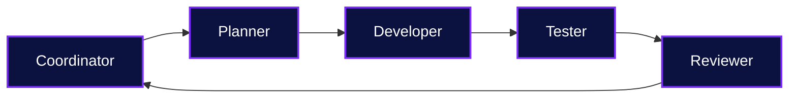
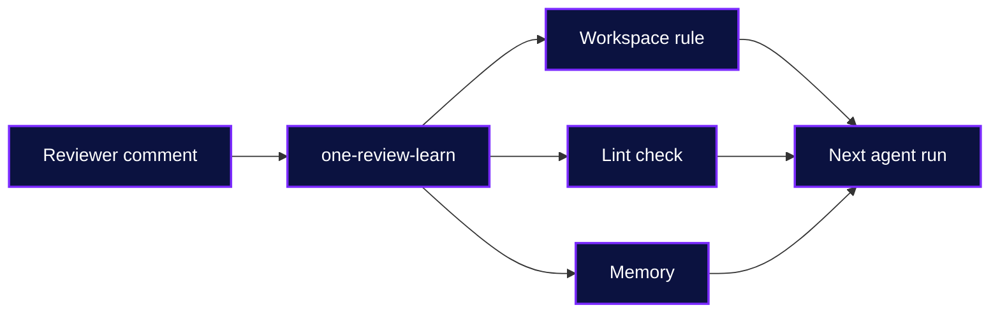
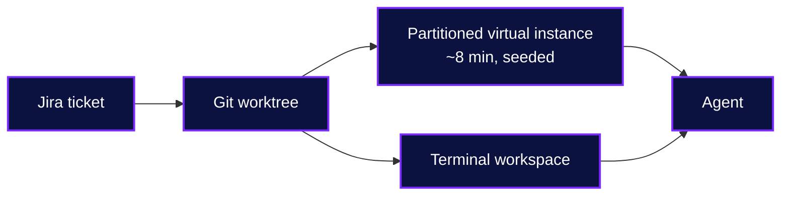
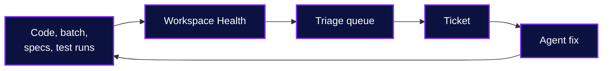

# The Agentic Workspace

Fast, Cheap, **and** Good

<!--
I lead the team that builds Liferay One: the internal product that runs our marketplace, projects, licensing, and support. We build it on Liferay, with client extensions only. [CHECK: claim about how much code agents write.]
-->

---
eyebrow: The Equation
---

Agent = Model + Harness

**Model**

- Reasons and writes the code
- Rented: everyone gets the same one
- Changes every few months

**Harness**

- Tools, skills, context, a sandbox, and guardrails
- Owned: built from your codebase and your reviews
- Compounds with every rule you add

Everyone has the same model. The harness is the part you build.

<!--
When people say "the agent did it", they usually mean the model. But the model is the part you rent. Your competitor rents the same one, and next quarter there is a new one. The harness is everything around the model: the tools it can call, the context it reads, the sandbox it runs in, and the guardrails that stop it. That part is yours, it is built from your own codebase and your own reviews, and it gets better every time you add a rule. So when the model changes, you do not start over. You plug the new model into the same harness. The rest of this talk is about the harness.
-->

---
eyebrow: DevCon 2026
---

# Related Talks

MCP

Stop Clicking, Start Prompting: Building on Liferay with AI and MCP

Alejandro Tardin

Tue 3 Nov · 11:55 · Main Stage

Harness

The Agentic Workspace

Ryan Schuhler

Wed 4 Nov · 11:35 · Track B

You are here

Skills

Building With Autonomous Agents in Workspace: Context, Loops, and Validation

Victor Ware

Wed 4 Nov · 14:40 · Track A

<!--
Three of us are talking about agents on Liferay this week. Yesterday, Alejandro showed MCP: building a whole solution on Liferay through conversation, no clicks. This afternoon at 14:40 in Track A, Victor goes deep on autonomous agents in the workspace: context, loops, and validation. Those talks are the engine: content through MCP, and code through skills. This talk is the harness around both: what makes the output trustworthy enough to ship. If you see all three, you get the whole system. [CHECK: the agenda is preliminary, so confirm the times and rooms the week before.]
-->
---
layout: statement
---

# Fast, Cheap, Good

## Pick two

AI alone gets you <strong>fast</strong>.

A harness gets you the other two.

<svg class="devcon-triangle__svg" viewBox="0 0 820 760">
<polygon points="410,90 80,660 740,660" class="devcon-triangle__edge" />
<circle cx="410" cy="90" r="22" class="devcon-triangle__dot" />
<circle cx="80" cy="660" r="22" class="devcon-triangle__dot" />
<circle cx="740" cy="660" r="22" class="devcon-triangle__dot" />
<g v-click="2">
<polygon points="410,90 80,660 740,660" class="devcon-triangle__edge devcon-triangle__edge--lit" />
<circle cx="80" cy="660" r="26" class="devcon-triangle__dot devcon-triangle__dot--lit" />
<circle cx="740" cy="660" r="26" class="devcon-triangle__dot devcon-triangle__dot--lit" />
</g>
<g v-click="1"><circle cx="410" cy="90" r="26" class="devcon-triangle__dot devcon-triangle__dot--lit" /></g>
<text x="410" y="40" class="devcon-triangle__label">Fast</text>
<text x="80" y="730" class="devcon-triangle__label">Cheap</text>
<text x="740" y="730" class="devcon-triangle__label">Good</text>
</svg>

<!--
Every one of you knows this rule: fast, cheap, good, pick two. The pitch for AI is that it breaks the triangle. [click] My experience is that AI alone just makes you fast. You get more code, sooner, and it is not cheaper to own or better to run. [click] The other two corners come from what you build around the model: the harness. That is what the rest of this talk is about.
-->

---
eyebrow: The Trifecta
---

# What the Corners Mean Here

<table>
<thead>
<tr><th>Corner</th><th v-click="1">Practices</th><th v-click="4">Principle</th></tr>
</thead>
<tbody>
<tr><td><strong>Fast</strong></td><td v-click="1">Tight Loops, Shift-Left</td><td v-click="4"><strong>Cadence</strong>: Agility through Feedback</td></tr>
<tr><td><strong>Cheap</strong></td><td v-click="2">Context, Automation</td><td v-click="5"><strong>Cost</strong>: Efficiency through Clarity</td></tr>
<tr><td><strong>Good</strong></td><td v-click="3">Standards, Observability</td><td v-click="6"><strong>Craft</strong>: Quality through Discipline</td></tr>
</tbody>
</table>

<!--
Keep these in mind. I'll come back to each one with numbers at the end.
-->

---
eyebrow: The Agentic SDLC
---

# Seven Phases, Three Stages

Planning

Analysis

Design

Implementation

Testing

Deployment

Maintenance

Discovery

Development

Delivery

<!--
You know these seven phases. Every methodology names them a little differently, but the work is the same. [click] For this talk I group them into three stages. Discovery: planning, analysis, and design, deciding what to build. Development: implementation and testing, building it and proving it works. Delivery: deployment and maintenance, shipping it and keeping it healthy. Agents change all three, but they change what each stage produces most of all. That is the next slide.
-->

---
eyebrow: The Agentic SDLC
---

# Deliverables Become Inputs

| Phase | Traditional Deliverable | Agentic Artifact |
| --- | --- | --- |
| **Planning** | Requirements document | `mockup.html` |
| **Analysis** | Requirements specification | `git diff specs/business` |
| **Design** | Architecture specification | `git diff specs/technical` |
| **Implementation** | Code commits | `git diff client-extensions` |
| **Testing** | Test reports | `yarn test:report` |
| **Deployment** | Release report | `yarn viz:diff` |
| **Maintenance** | Performance report | `yarn viz` |

A traditional deliverable is read once by a person. An agentic artifact is read every run by an agent, and checked.

<!--
Same seven phases you already know. The phases did not change. What changed is who reads the output of each phase. On the left, every deliverable is a document a person reads once, signs off, and then it goes stale. [click] On the right, every artifact is an input: the next agent reads it on every run, and something in the harness checks it. A requirement that no test cites fails plan:check. A rule that the code breaks fails lint. The last two rows are the same tool read two ways: yarn viz builds Workspace Health for the whole workspace, and yarn viz:diff shows what one branch adds to it and resolves. That is the shift: deliverables become inputs. Later, in Guardrails, I come back to this table to show where the humans still sit.
-->

---
eyebrow: The Harness
---

# Four Parts of the Harness

| Part | Concretely | In Our Workspace |
| --- | --- | --- |
| **Tools** | Tools, skills, MCP servers, and their descriptions; orchestration: subagents, handoffs, model routing | 46 skills, the Liferay MCP server, headless APIs |
| **Context** | System prompts, rules, specs, memory | `AGENTS.md`, 20 rules, 822 requirement IDs, review lessons |
| **Sandbox** | Bundled infrastructure: filesystem, sandbox, browser | A worktree and a Liferay instance per ticket, Playwright |
| **Guardrails** | Hooks and middleware for deterministic steps, permissions, approvals, monitoring | Lint, tests, automated reports, human approval |

<!--
This is the map for the rest of the talk. Concretely, a harness is the system prompt, the tools and skills and MCP servers with their descriptions, the infrastructure the agent runs in, the orchestration that spawns subagents and routes between models, and the hooks that run deterministic steps like lint checks. We group those into four parts, one section each: tools, context, sandbox, guardrails. Then the numbers.
-->

---
layout: section
eyebrow: Part 1
---

# Tools

---
eyebrow: Tools
---

# Skills Are Tools With Instructions

46

skills in the workspace

MCP

Liferay content, objects, and pages

APIs

headless REST and the Spring Boot sidecar

- A skill wraps a tool with its procedure and its failure modes — `/one-deploy`, `deploy-and-verify`
- When an agent keeps getting a step wrong, turn the step into a script
- A tool is only as good as its description: it decides when the agent uses it

<!--
A raw API gives the agent a capability. A skill gives it the capability plus how to use it here, and what goes wrong. The description matters as much as the tool: it is what the agent reads to decide when to use it, so a vague description means a skill that never loads. The deploy skill does not just deploy: it checks that the bundle actually started. When an agent kept waiting on a counter that had already moved, we stopped describing the step in prose and wrote a script. [CHECK: the MCP claim.]
-->

---
eyebrow: Tools · Orchestration
---

# Orchestration Is a Tool Too

- **Subagents** — `/one-team` runs four specialists; the coordinator never writes code, the reviewer is read only
- **Handoffs** — written files (`plan.md`, `dev-handoff.md`, `review.md`), not a conversation
- **Model routing** — a small model collects, a medium model analyzes, the large model decides

<!--
Orchestration is the tool that uses the other tools. /one-team takes a ticket from plan to reviewed code with four specialists. The coordinator only relays and enforces the phase gates. Every handoff is a file: the plan, the developer handoff, the review. That keeps each agent's context small and lets a human read exactly what was passed along. Model routing is orchestration too: one-review-learn collects on a small model, analyzes on a medium one, and keeps only the final decision on the large one. [CHECK: the phase order and file names against one-team before the talk.]
-->

---
layout: section
eyebrow: Part 2
---

# Context

---
eyebrow: Context
---

# Rules: What the Agent Knows

20

rules, scoped by path

822

requirement IDs in the specs

72

commits to agent docs since May

> **Guest Access** — Every rule here fails silently: the page returns 200, the entry saves, nothing appears in the log.

<!--
A rule is a fact. A skill is a procedure. The skills are tools; the rules are context. We keep them separate so a procedure can cite a fact instead of repeating it.
-->

---
eyebrow: Context
---

# Context Rots

**In the window**

- Rules load only for the code they govern
- Skills load on demand, by description
- Subagents read; the session keeps the answer
- `/one-review` records whether the reviewer was fresh

**In the repository**

- Rules carry evidence: "verified on 2026.Q2"
- When prose and code disagree, the code wins
- `plan:check` and `viz:check` fail on drift

More context is not better context. The right context, at the right time, still true.

<!--
Context rot happens in two places. In the window: the longer a session runs and the more it reads, the worse the model gets at using what it read. So we keep the window small on purpose. Rules are scoped by path, skills load only when their description matches the task, and subagents do the broad reading and hand back a conclusion. The sharpest version of this is review: a session that wrote the code, or was briefed by one that did, reviews it worse, and it cannot tell from the inside. So our review skill records whether the reviewer was fresh, briefed, or the author. In the repository: a doc that was true in June misleads an agent in October. So the rules carry the version they were verified on, the code is the source of truth when prose disagrees, and two checks fail the build when the docs drift. [CHECK: 9 of 20 rules are path scoped today.]
-->

---
eyebrow: Context · Intent
---

# The Spec Is Checked

822

requirement IDs across business and technical specs

`yarn plan:check` fails when:

- Code exists that the test plan does not cover
- A test cites no requirement

<!--
This is the pillar people skip. Without intent, an agent builds the wrong thing very well.
-->

---
eyebrow: Context
---

# Writing for Agents Is Writing for Humans

- **Simplified Technical English** — one word, one meaning, short sentences
- **No code comments** — descriptive names instead
- **Evidence in the doc** — "verified on 2026.Q2", the source class named

<!--
We adopted a controlled language because the team is global. It is also the best way to write for a model.
-->

---
eyebrow: Context · Feedback
---

# Every Review Comment Becomes a Guardrail

<!--
Our reviewer comments "sort" on a PR. Once. That comment becomes a rule, and no agent makes the mistake again. [CHECK: use a real PR here.]
-->

---
layout: section
eyebrow: Part 3
---

# Sandbox

---
eyebrow: Sandbox
---

# Declarative Means Disposable

- The site initializer and the batch client extension are the source of truth
- Objects, picklists, pages, and permissions are JSON in the repository
- Any sandbox can be deleted and rebuilt from the tree

> If an agent can rebuild its sandbox, being wrong costs minutes.

---
layout: statement
---

# Low code is agent code

<!--
Liferay invested years in low code: objects, fragments, site initializers. Those are the easiest things for an agent to write and verify, because they are declarative.
-->

---
eyebrow: Sandbox
---

# A Worktree per Ticket

**Why**

- Two agents in one checkout overwrite each other
- A worktree isolates the files and shares the git history
- It takes seconds, not a new clone

**How**

- `/one-worktree LPD-12345` — worktree, terminal workspace, and Liferay instance
- `/start-my-tickets` — one per ticket, in parallel
- `/review-my-prs` — each PR rebased into its own worktree

A second worktree costs one database schema and one sidecar, not a second 10 GB stack.

<!--
The first time we ran two agents at once, they shared one checkout, and one session reverted the other's uncommitted work. Now every ticket gets its own git worktree, branched off master-temp. It shares the repository's history, so it is ready in seconds. One command creates the worktree, opens it in its own terminal workspace, and provisions a Liferay virtual instance for it. Two rules came out of this: commit early, and never use a bare git stash, because the stash is shared by every worktree. [CHECK: the scar story, and the slash commands named here.]
-->

---
eyebrow: Sandbox
---

# One Sandbox per Agent

<!--
Parallel agents need parallel sandboxes. Otherwise they share one database and break each other's tests.
-->

---
layout: section
eyebrow: Part 4
---

# Guardrails

---
eyebrow: Guardrails · Policy
---

# Lint the Agent Cannot Argue With

- **10** custom ESLint rules — folder structure, file naming, no comments
- `ls-lint` for the file system
- **50** numbered style rules in `pr-reviewer/rules` for the whole repository

> A doc says "please." A lint rule says "no."

---
eyebrow: Guardrails · Behavior
---

# Tests at Every Tier

246

Vitest files

234

JUnit files

32

Playwright specs

- Tests go in their own commit, so the reviewer reads what the change proves
- `one-test-add` picks the tier

---
eyebrow: Guardrails · Monitoring
---

# The Harness Reports on Itself

- **Built from the source** — 9 extractors, one tab per layer: Model, View, Controller, Workspace
- **Every problem becomes an action** — plus a triage queue for the ones no ticket tracks
- **Drift fails the build** — `yarn viz:check`; `yarn viz:diff` shows what a branch adds and resolves

<!--
Lint and tests catch failures in one change. Workspace Health catches them across the whole workspace. Nobody maintains these pages by hand: every visual is extracted from the code, so the page cannot go stale. Anything that needs attention becomes an action, and the Overview shows a triage queue: the actions that no ticket, audit ID, or known defect tracks yet. Hand that queue to an agent and it closes the loop. /one-viz rebuilds it and republishes it to the same link, so the link in my bookmarks is always current. [Show a screenshot or a 20 second clip of the live page here. Publish it private: it shows where the audit found exploitable defects.] [CHECK: what runs it automatically, and how often?]
-->

---
eyebrow: Guardrails · Human in the Loop
---

# Where the Humans Are

| Phase | Artifact | Human Checkpoint |
| --- | --- | --- |
| Planning | `/plan-my-tickets` | Approve the plan |
| Analysis | `specs/business` | Own the requirements |
| Design | `specs/technical` | Approve the design |
| Implementation | Skills and rules | — |
| Testing | `plan:check`, `/one-test` | — |
| Deployment | `/one-pr`, `/one-pr-forward` | Merge |
| Maintenance | Memory, `one-review-learn` | Review the new rule |

<!--
Look at where the humans are: at intent and at merge. The middle is the harness.
-->

---
eyebrow: Guardrails · Human in the Loop
---

# What Humans Still Own

**Humans own**

- **Intent** — the requirements and the approved plan
- **Judgment** — the merge, and every new rule
- **The harness** — what it checks, and what it lets through

**The harness enforces it**

- `/plan-my-tickets` stops and waits for approval
- `/one-team` cannot pass a phase gate on its own
- The reviewer agent is read only
- The coordinator never writes code

A human comment used to fix one PR. Now it becomes a rule that every agent follows.

<!--
Human in the loop does not mean a human approves every step. It means the human sits where judgment matters: what we build, whether it ships, and what the harness checks. Everything between those points is the harness. The leverage changed too. A review comment used to fix one PR. Now one-review-learn turns it into a rule, so the same comment shapes every agent run after it. [CHECK: confirm each enforcement bullet against the skills before the talk.]
-->

---
layout: section
eyebrow: Demo
---

# Demo

<!--
To be decided.
-->

---
layout: section
eyebrow: Part 5
---

# Metrics

<!--
Section cleared for rework. The previous numbers are in outline.md.
-->

---
eyebrow: Metrics
---

# What We Measure

| | Cadence | Cost | Craft |
| --- | --- | --- | --- |
| **Discovery** | Time to Plan | Tokens per Plan | Requirement Rework Rate |
| **Development** | Time to Merge | Tokens per Merge | Defect Escape Rate |
| **Deployment** | Time to Production | Tokens per Deploy | Change Failure Rate |

---
eyebrow: Takeaways
---

# Four Things to Take Home

<v-clicks>

1. Turn deliverables into inputs that an agent reads and the harness checks
2. Turn every review comment into a rule, a lint check, or a test
3. Give every agent its own sandbox, so being wrong is cheap
4. Measure it, including the cost

</v-clicks>

---
layout: cover
eyebrow: Thank You
speaker: Ryan Schuhler
role: Team Lead, Liferay
---

# Questions?
